<p align="center">
  <picture>
    <source media="(prefers-color-scheme: dark)" srcset="docs/readme/banner-a-dark.png">
    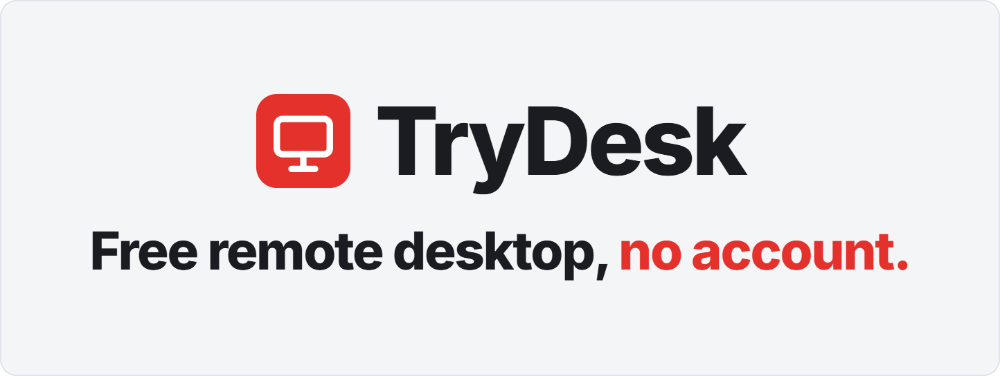
  </picture>
</p>

<p align="center">
  Control a Windows PC from another Windows PC, a Mac, Linux or an Android phone.<br>
  The two devices connect directly, so your screen and files never pass through our server.
</p>

<p align="center">
  <a href="https://trydesk.ai.id/downloads/"><b>Download</b></a>
  &nbsp;·&nbsp;
  <a href="https://trydesk.ai.id/docs/">How to use it</a>
  &nbsp;·&nbsp;
  <a href="#run-it-from-source">Run from source</a>
  &nbsp;·&nbsp;
  <a href="https://trydesk.ai.id/donate/">Donate</a>
  <br>
  <b>English</b> &nbsp;·&nbsp; <a href="docs/README.id.md">Bahasa Indonesia</a>
</p>

## Connect in three steps

### 1. The PC that needs help shares its ID

<p>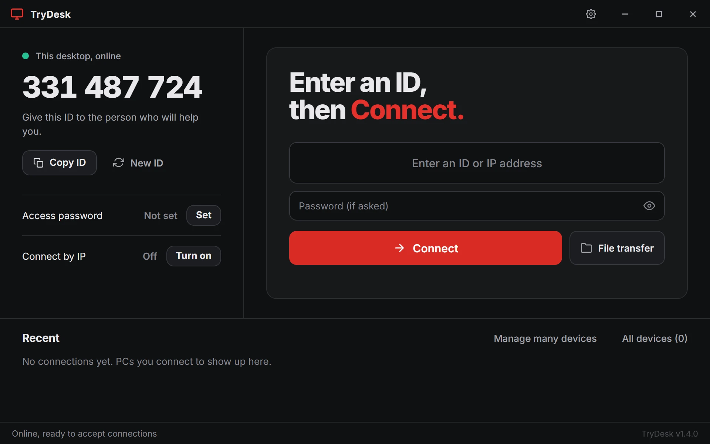</p>

Open TryDesk on the PC you want to reach. Its 9-digit ID is the big number on the left. Send that number to the person who will help.

### 2. Type the ID on your side

<p>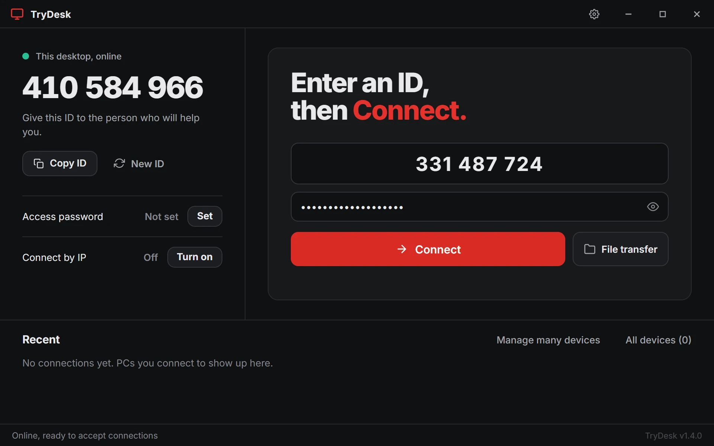</p>

On your own device, type the ID and press **Connect**. If the other PC has an access password, type it too.

### 3. The other side accepts

<p>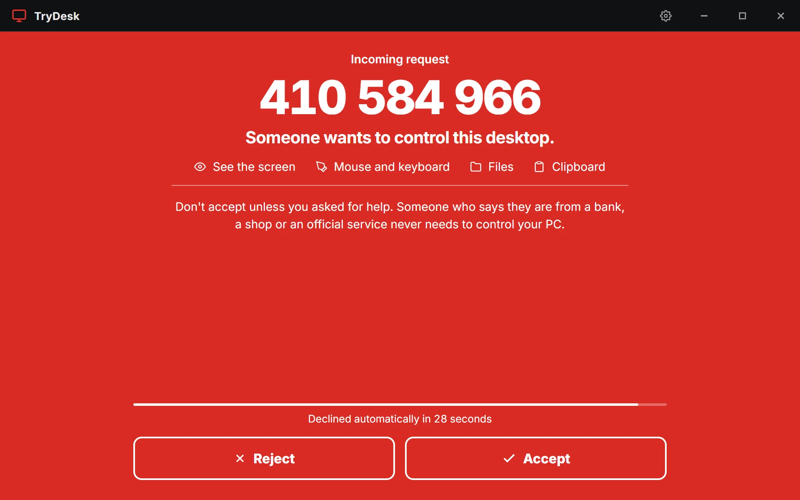</p>

The other PC shows who is asking and what they will be able to do. Nothing happens until someone there presses **Accept**.

### Then you are in

<p>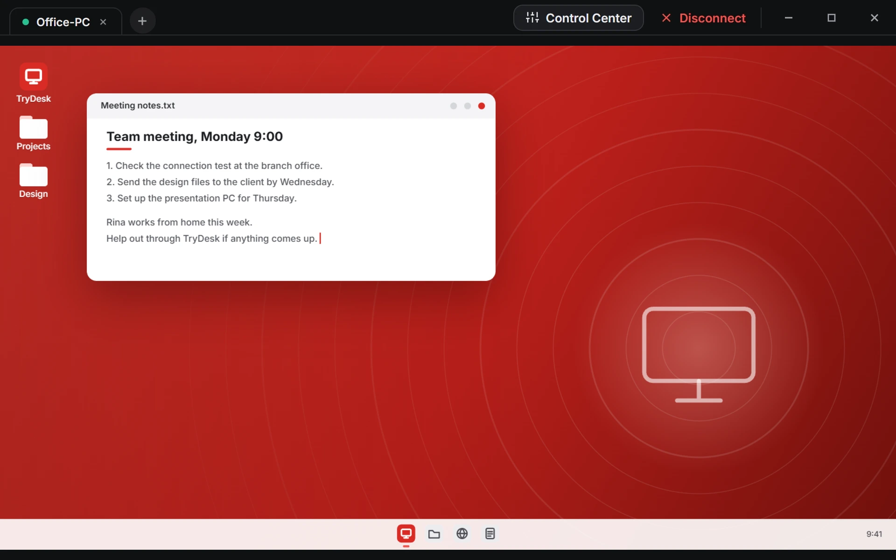</p>

The other PC's screen fills your window, and your mouse and keyboard work on it. Several PCs can be open at once, each in its own tab.

## Which device can do what

| Device | Can control | Can be controlled |
| --- | --- | --- |
| Windows 10, 11 | Yes | Yes |
| macOS 13+ | Yes | No |
| Linux | Yes | No |
| Android 7.0+ | Yes | No |

Downloads: installer or portable .exe for Windows, .zip for Apple Silicon and Intel Macs, AppImage or .deb for Linux, and a 3 MB APK for Android.

## How a connection works

<p>
  <picture>
    <source media="(prefers-color-scheme: dark)" srcset="docs/readme/how-it-connects-dark.png">
    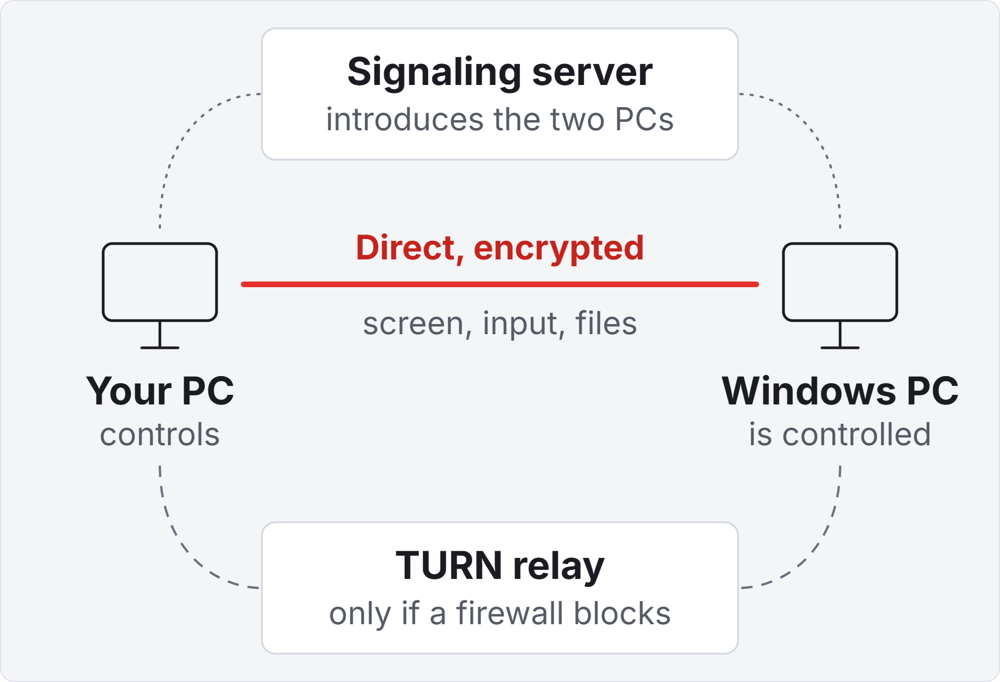
  </picture>
</p>

Each app gets a 9-digit ID from the signaling server. You type the other PC's ID, the server passes a few setup messages between the two, and from then on they talk directly over WebRTC, encrypted with DTLS-SRTP. The server never sees the screen or the files. On a network that blocks direct connections, the traffic goes through a TURN relay instead.

## In a session

<p>
  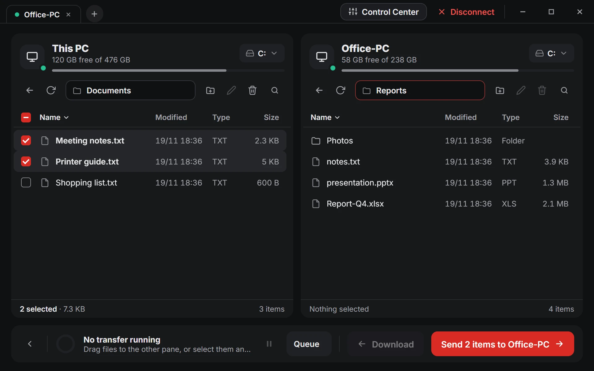
  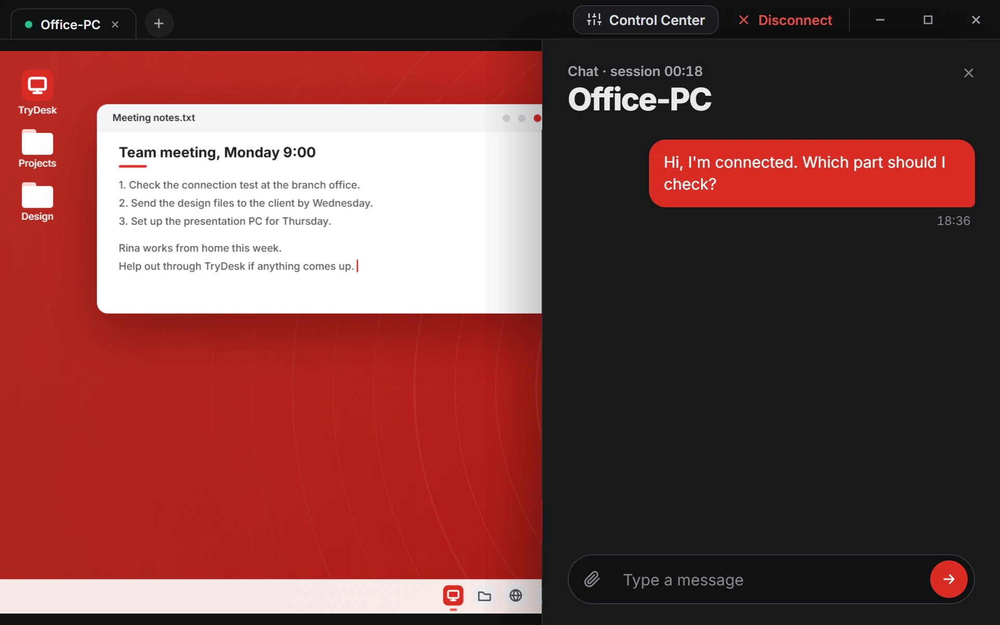
</p>

Copy files both ways in a two-panel file manager, or drag a file onto the remote screen to send it. Chat with the person on the other side without leaving the session.

<p>
  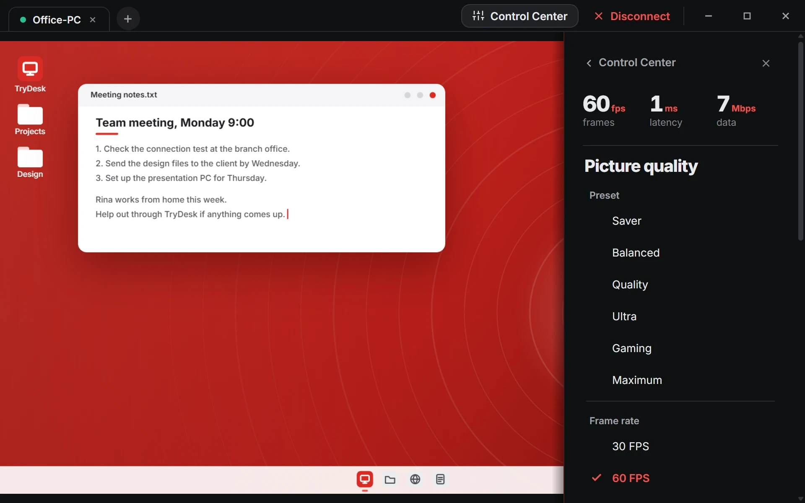
  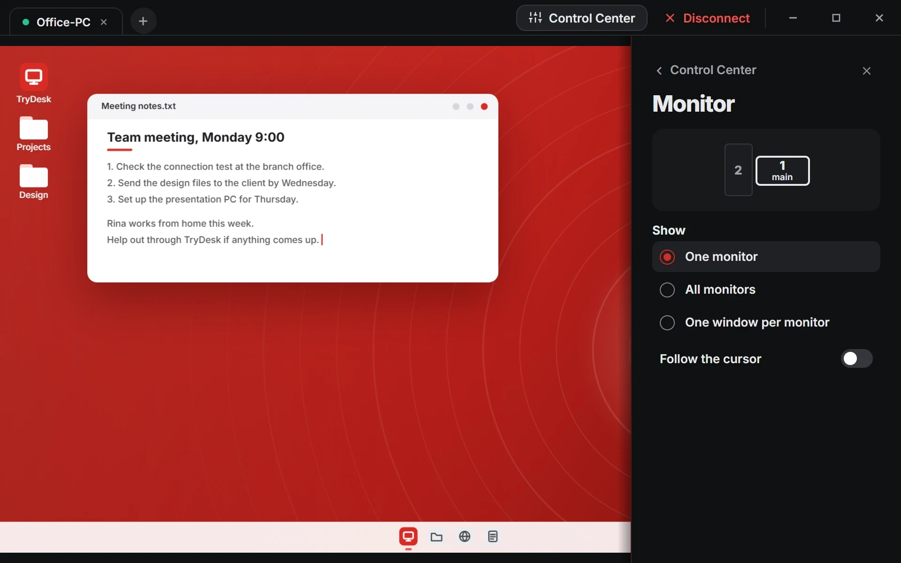
</p>

Change frame rate, bitrate, resolution and codec while you work, and switch between the remote PC's monitors.

<p>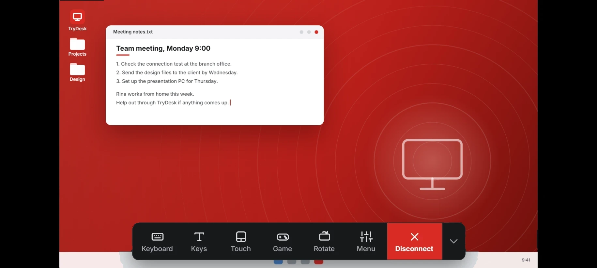</p>

On an Android phone, the toolbar gives you the keyboard, special keys, touch or touchpad mode and game mode.

## Features

### Control
- Full keyboard, including Alt+Tab and the Windows key
- Game mode with relative mouse, for games that lock the pointer
- Several monitors on the host: switch mid-session, or show them all at once (side by side, or one window per monitor)
- Several remote PCs at once, each in its own tab

### Picture
- Up to 240 FPS from a Windows host through the fast path; the host monitor has to refresh that fast
- AV1, VP9, VP8 and H.264, changeable during the session

### Also
- Shared clipboard, remote audio and session recording to .webm
- Connect by IP on a local network, with no internet and no server
- Indonesian and English, dark and light theme

## Is it safe?

- The screen, mouse, keyboard and files travel directly between the two devices, encrypted. Our server only introduces them.
- The controlled PC decides: it can refuse, ask for an access password, or allow view-only. Control, files and clipboard can each be turned off.
- During a session the host's screen can be blacked out and its input locked, and a device can get a new ID at any time.
- The request screen warns that banks, shops and official services never need to control your PC.
- Every download's SHA-256 is on [the website](https://trydesk.ai.id/downloads/), and all of the code is here.

> [!NOTE]
> Builds are not code-signed yet, so Windows SmartScreen warns the first time: choose **More info**, then **Run anyway**. On a Mac, run `xattr -cr /Applications/TryDesk.app` once.

Found a security problem? Follow [`SECURITY.md`](SECURITY.md) instead of opening a public issue.

## Run it from source

You need [Node.js](https://nodejs.org/) 22.12 or newer. The desktop app builds on Windows only.

```bash
git clone https://github.com/TryDesk/TryDesk.git
cd TryDesk
npm install
npm run dev     # starts the signaling server and the app together
```

The app uses the public signaling server unless you change `signalingServer` in `src/config.json`.

<details>
<summary><b>Build the Windows app</b></summary>

```bash
npm run build            # portable + installer, into dist/
npm run build:portable   # portable .exe only
npm run build:installer  # installer only
```

Each build writes its size and SHA-256 next to the files.
</details>

<details>
<summary><b>Build the macOS and Linux apps</b></summary>

```bash
bash scripts/build-mac.sh                             # on a Mac
bash scripts/build-mac-wsl.sh /mnt/c/path/to/project  # in WSL, without a Mac
bash scripts/build-linux.sh /mnt/c/path/to/project    # in WSL, into dist-linux/
```

Step-by-step Mac guide: [`docs/BUILD-MAC.md`](docs/BUILD-MAC.md).
</details>

<details>
<summary><b>Build the Android app</b></summary>

Needs JDK 21 and the Android SDK (platform 36). Details in [`mobile/README.md`](mobile/README.md).

```bash
cd mobile
npm install
npm run apk:debug
```
</details>

<details>
<summary><b>Run your own signaling server</b></summary>

```bash
cd deploy
cp .env.example .env      # set your domain and a TURN secret
docker compose up -d --build
```

Caddy gets the HTTPS certificate and coturn runs the TURN relay. `deploy/setup.sh` walks through a fresh Ubuntu server.
</details>

<details>
<summary><b>Where things live in the code</b></summary>

```
src/            Desktop app (Electron 45)
  main.js         Screen capture, input, files, windows
  renderer/       The UI; app.js is the place to start reading
mobile/         Android app (Capacitor 8, same renderer)
server/         Signaling server (Node.js + ws)
deploy/         Docker Compose: signaling, Caddy, coturn
scripts/        Release and build helpers
docs/           Guides
```
</details>

## Contributing

Issues and pull requests are welcome, including first ones. Read [`CONTRIBUTING.md`](CONTRIBUTING.md) first. No GitHub account? Email support@trydesk.ai.id.

## Made by one person

TryDesk is a hobby project by DrWeabo, with no ads and no paid tier. If it helps you, you can [donate](https://trydesk.ai.id/donate/) for the server costs, report a bug, or tell a friend.

## License

Copyright © 2026 DrWeabo. TryDesk 1.2.0 and later are free software under the [GNU AGPL v3.0](LICENSE) (1.1.1 and earlier were MIT). If you share a modified version, or let people use it over a network, publish its source under the same licence and keep the "Made by DrWeabo" credit. The TryDesk name and logo are trademarks and are not covered by the licence; see [`TRADEMARK.md`](TRADEMARK.md).
