<p align="center">
  <picture>
    <source media="(prefers-color-scheme: dark)" srcset="readme/banner-a-id-dark.png">
    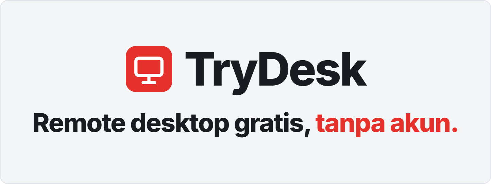
  </picture>
</p>

<p align="center">
  Kontrol PC Windows dari PC Windows lain, Mac, Linux, atau HP Android.<br>
  Kedua perangkat tersambung langsung, jadi layar dan file Anda tidak lewat server kami.
</p>

<p align="center">
  <a href="https://trydesk.ai.id/downloads/"><b>Unduh</b></a>
  &nbsp;·&nbsp;
  <a href="https://trydesk.ai.id/docs/">Cara pakai</a>
  &nbsp;·&nbsp;
  <a href="#jalankan-dari-source">Jalankan dari source</a>
  &nbsp;·&nbsp;
  <a href="https://trydesk.ai.id/donate/">Donasi</a>
  <br>
  <a href="../README.md">English</a> &nbsp;·&nbsp; <b>Bahasa Indonesia</b>
</p>

## Tersambung dalam tiga langkah

### 1. PC yang perlu dibantu memberikan ID-nya

<p>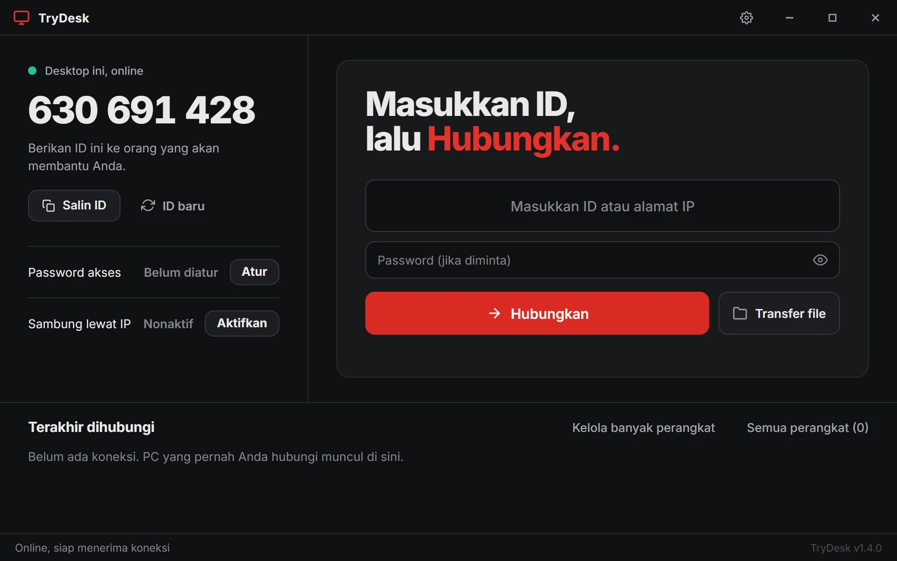</p>

Buka TryDesk di PC yang ingin dikontrol. ID 9 digitnya adalah angka besar di sebelah kiri. Kirim angka itu ke orang yang akan membantu.

### 2. Ketik ID itu di perangkat Anda

<p>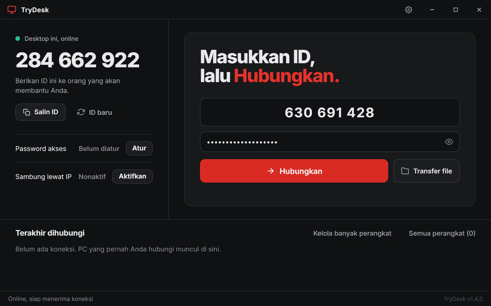</p>

Di perangkat Anda sendiri, ketik ID tadi lalu tekan **Hubungkan**. Kalau PC tujuan memakai password akses, ketik juga password-nya.

### 3. PC tujuan menerima

<p>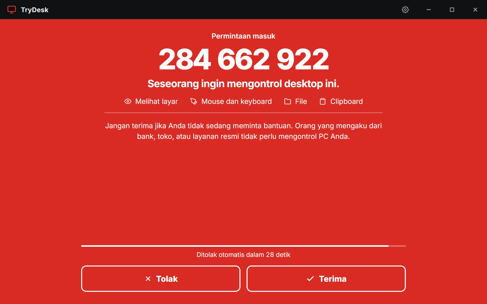</p>

PC tujuan melihat siapa yang meminta dan apa saja yang boleh dilakukan. Tidak ada yang terjadi sampai orang di sana menekan **Terima**.

### Lalu Anda sudah masuk

<p>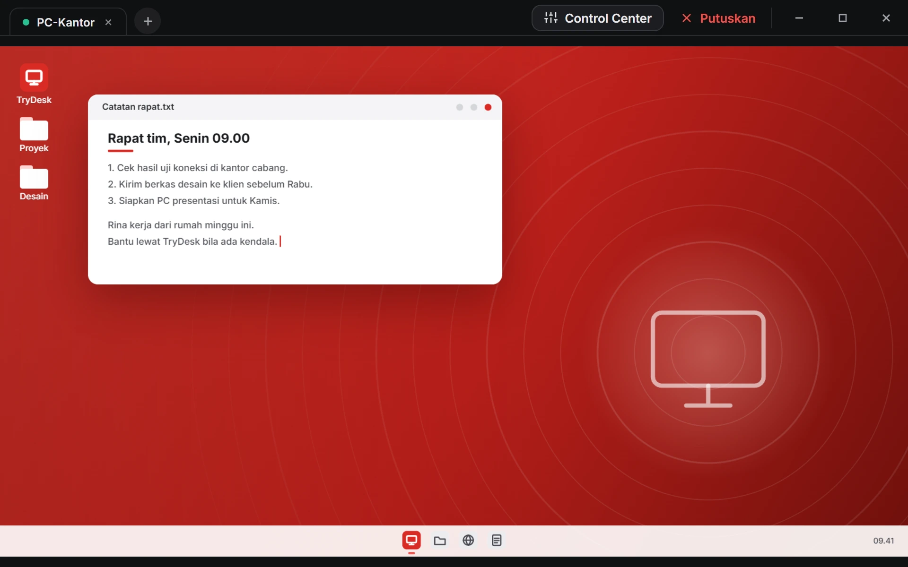</p>

Layar PC tujuan tampil di jendela Anda, dan mouse serta keyboard Anda bekerja di sana. Beberapa PC bisa dibuka sekaligus, masing-masing di tab sendiri.

## Perangkat mana bisa apa

| Perangkat | Bisa mengontrol | Bisa dikontrol |
| --- | --- | --- |
| Windows 10, 11 | Ya | Ya |
| macOS 13+ | Ya | Tidak |
| Linux | Ya | Tidak |
| Android 7.0+ | Ya | Tidak |

Unduhan: installer atau .exe portable untuk Windows, .zip untuk Mac Apple Silicon dan Intel, AppImage atau .deb untuk Linux, dan APK 3 MB untuk Android.

## Cara koneksinya bekerja

<p>
  <picture>
    <source media="(prefers-color-scheme: dark)" srcset="readme/how-it-connects-id-dark.png">
    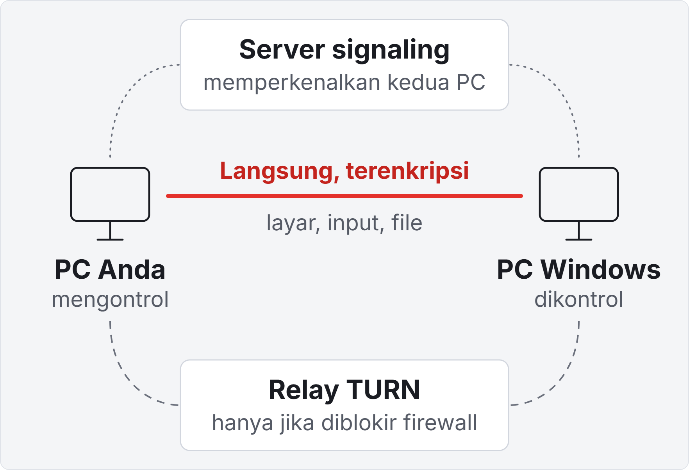
  </picture>
</p>

Setiap aplikasi mendapat ID 9 digit dari server signaling. Anda mengetik ID PC lain, server meneruskan beberapa pesan persiapan, dan setelah itu kedua PC berbicara langsung lewat WebRTC dengan enkripsi DTLS-SRTP. Server tidak pernah melihat layar atau file. Di jaringan yang memblokir koneksi langsung, data lewat relay TURN.

## Di dalam sesi

<p>
  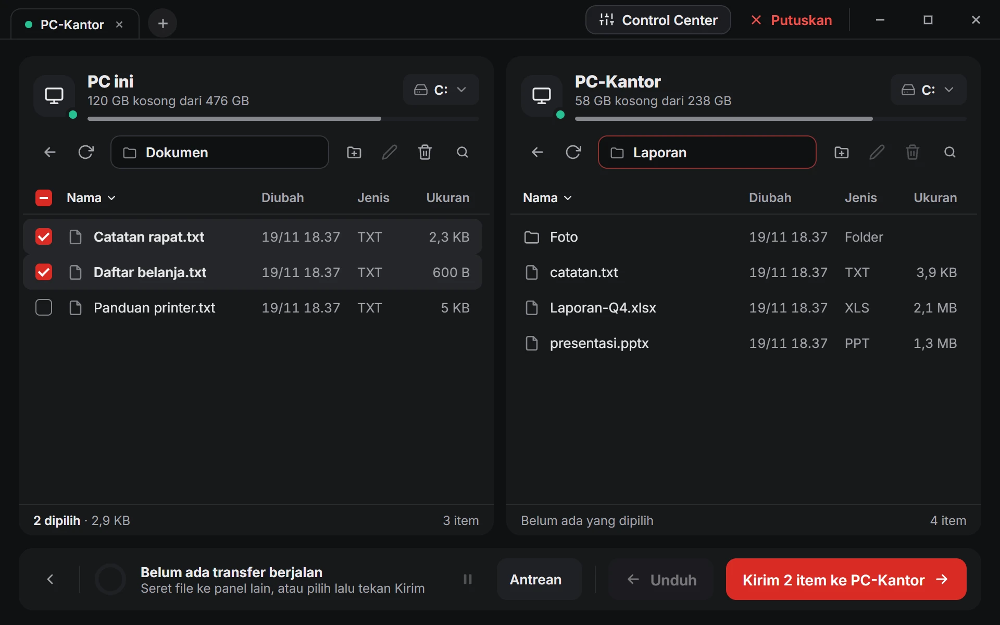
  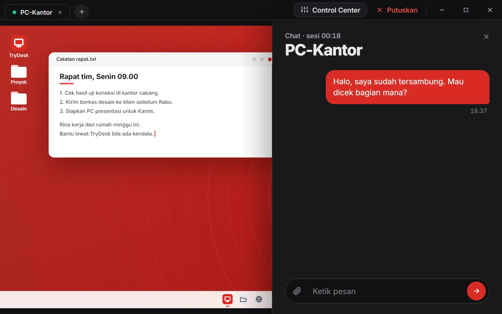
</p>

Kirim file dua arah lewat pengelola file dua panel, atau seret file ke layar remote untuk mengirimnya. Chat dengan orang di seberang tanpa keluar dari sesi.

<p>
  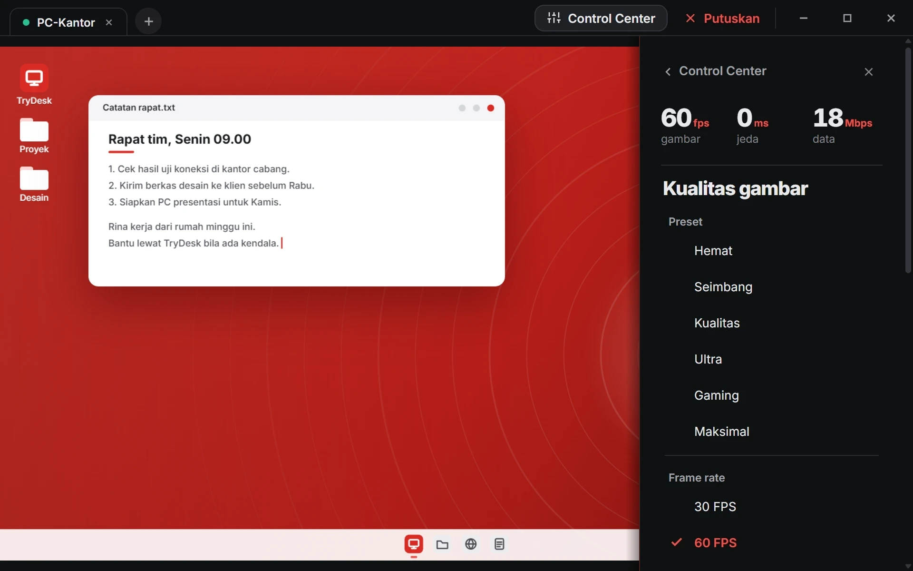
  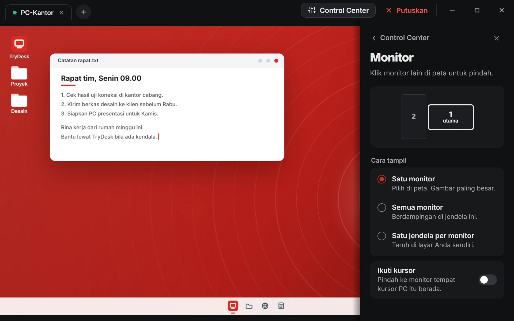
</p>

Ubah frame rate, bitrate, resolusi, dan codec sambil bekerja, dan pindah antar-monitor PC tujuan.

<p>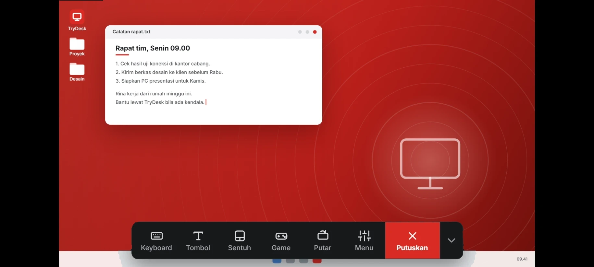</p>

Di HP Android, toolbar berisi keyboard, tombol khusus, mode sentuh atau touchpad, dan mode game.

## Fitur

### Kontrol
- Keyboard lengkap, termasuk Alt+Tab dan tombol Windows
- Mode game dengan mouse relatif, untuk game yang mengunci kursor
- Beberapa monitor di PC tujuan: ganti di tengah sesi, atau tampilkan semuanya sekaligus (berdampingan, atau satu jendela per monitor)
- Beberapa PC sekaligus, masing-masing di tab sendiri

### Gambar
- Hingga 240 FPS dari PC Windows lewat jalur cepat; monitor PC tujuan harus mendukung refresh rate setinggi itu
- AV1, VP9, VP8, dan H.264, bisa diganti di tengah sesi

### Lainnya
- Clipboard bersama, suara dari PC tujuan, dan rekam sesi ke .webm
- Sambung lewat IP di jaringan lokal, tanpa internet dan tanpa server
- Bahasa Indonesia dan Inggris, tema gelap dan terang

## Apakah aman?

- Layar, mouse, keyboard, dan file berjalan langsung di antara kedua perangkat, terenkripsi. Server kami hanya memperkenalkan keduanya.
- PC tujuan yang menentukan: bisa menolak, meminta password akses, atau hanya mengizinkan melihat. Kontrol, file, dan clipboard bisa dimatikan satu per satu.
- Selama sesi, layar PC tujuan bisa digelapkan dan input-nya dikunci. ID perangkat bisa diganti kapan saja.
- Layar permintaan mengingatkan bahwa bank, toko, dan layanan resmi tidak perlu mengontrol PC Anda.
- SHA-256 setiap unduhan ada di [situs](https://trydesk.ai.id/downloads/), dan seluruh kodenya ada di sini.

> [!NOTE]
> Aplikasi belum ditandatangani (code signing), jadi Windows SmartScreen memberi peringatan saat pertama dibuka: pilih **More info**, lalu **Run anyway**. Di Mac, jalankan `xattr -cr /Applications/TryDesk.app` sekali.

Menemukan celah keamanan? Ikuti [`SECURITY.md`](../SECURITY.md), jangan membuka issue publik.

## Jalankan dari source

Anda perlu [Node.js](https://nodejs.org/) 22.12 atau lebih baru. Aplikasi desktop hanya bisa di-build di Windows.

```bash
git clone https://github.com/TryDesk/TryDesk.git
cd TryDesk
npm install
npm run dev     # menjalankan server signaling dan aplikasi sekaligus
```

Aplikasi memakai server signaling publik, kecuali Anda mengganti `signalingServer` di `src/config.json`.

Perintah build untuk Windows, macOS, Linux, Android, dan cara menjalankan server sendiri ada di [README bahasa Inggris](../README.md#run-it-from-source). Panduan lengkap berbahasa Indonesia: [`docs/CARA-PAKAI.md`](CARA-PAKAI.md).

## Ikut berkontribusi

Issue dan pull request diterima, termasuk yang pertama kali. Baca [`CONTRIBUTING.md`](../CONTRIBUTING.md) dulu. Tidak punya akun GitHub? Kirim email ke support@trydesk.ai.id.

## Dibuat oleh satu orang

TryDesk adalah proyek hobi DrWeabo, tanpa iklan dan tanpa paket berbayar. Kalau TryDesk membantu Anda, Anda bisa [berdonasi](https://trydesk.ai.id/donate/) untuk biaya server, melaporkan bug, atau mengenalkannya ke teman.

## Lisensi

Hak cipta © 2026 DrWeabo. TryDesk 1.2.0 ke atas adalah perangkat lunak bebas dengan lisensi [GNU AGPL v3.0](../LICENSE) (1.1.1 ke bawah memakai MIT). Kalau Anda membagikan versi yang diubah, atau membiarkan orang memakainya lewat jaringan, terbitkan source-nya dengan lisensi yang sama dan pertahankan kredit "Made by DrWeabo". Nama dan logo TryDesk adalah merek dagang dan tidak termasuk dalam lisensi; lihat [`TRADEMARK.md`](../TRADEMARK.md).
